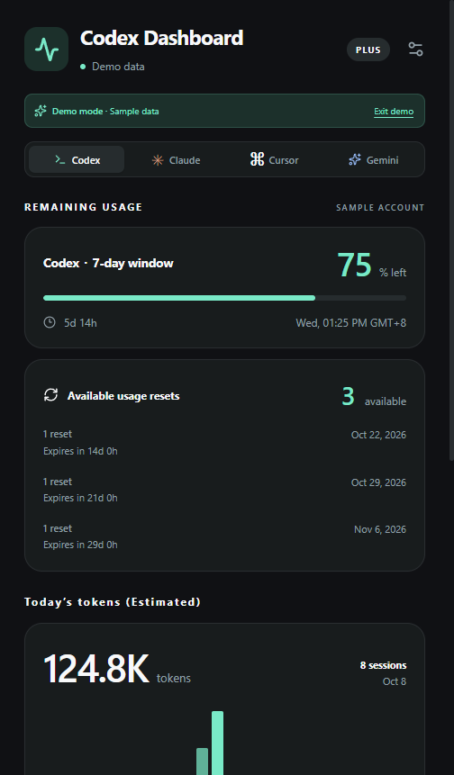
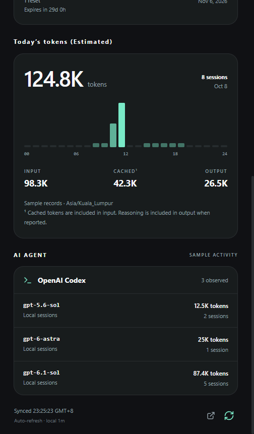

# Codex Dashboard

A Windows desktop dashboard that puts AI usage in your system tray. Check recorded Codex usage, Claude Code token activity, and manually tracked Cursor and Gemini limits without sending your data to a server.

An independent, original project inspired by [CodexBar](https://codexbar.app/?lang=en). No upstream code or assets are included. This project is not affiliated with CodexBar, OpenAI, Anthropic, Cursor, or Google.

## What it tracks

| Provider    | Source                    | Available information                                                                                |
| ----------- | ------------------------- | ---------------------------------------------------------------------------------------------------- |
| Codex       | Local session JSONL files | Recorded rate-limit windows and resets, token activity, sessions, and model information when present |
| Claude Code | Local project JSONL files | Recorded token activity and sessions; **not subscription quota or remaining plan usage**             |
| Cursor      | Manual entry              | A usage percentage, reset time, window name, and optional plan label                                 |
| Gemini      | Manual entry              | A usage percentage, reset time, window name, and optional plan label                                 |

The app starts with real local data. The tray and desktop window share a compact, scrollable black-and-mint layout: provider tabs, remaining-usage cards, today's token chart, and model activity. Hourly activity uses your computer's local timezone; unavailable details stay unreported. Demo mode is an explicit, labeled option for exploring the interface.

It includes automatic refresh, optional low-remaining-usage notifications for fresh local Codex quota, opt-in launch at login, theme settings, local folder selection, and JSON export.

| Remaining usage · sample data                                 | Token and model activity · sample data                                 |
| ------------------------------------------------------------- | ---------------------------------------------------------------------- |
|  |  |

## Run on Windows

The first release targets Windows x64. The installer is an **unsigned developer build**; Windows may display a publisher or SmartScreen warning. Verify that the download comes from this repository before running it.

1. Open [Build Windows desktop app](https://github.com/Haochihaochi/codex-dashboard/actions/workflows/build.yml) and choose **Run workflow**.
2. After a successful run, download the `Codex-Dashboard-windows-x64` artifact and extract it.
3. Run `Codex-Dashboard-0.1.0-windows-x64.exe` and follow the installer.

Workflow artifacts are retained for 14 days. You can also build the installer locally using the commands below. There is no automatic updater.

On first launch, open **Settings** to select the local data folders if they are not detected. The usual locations are `%USERPROFILE%\.codex` for Codex and `%USERPROFILE%\.claude` for Claude Code. The scanner reads their session/project subfolders; you can also select a `sessions` or `projects` folder directly. A custom Codex home must be selected explicitly. Signing in and using the provider's own app or CLI creates the source records; Codex Dashboard does not sign in to providers.

Closing the dashboard leaves the app in the tray. Use the tray menu to reopen it or quit. Enable notifications and launch at login only if you want them.

## Develop

Use Node.js 24 and npm on Windows.

```powershell
git clone https://github.com/Haochihaochi/codex-dashboard.git
cd codex-dashboard
npm ci
npm run dev
```

```powershell
npm test
npm run build
npm run test:desktop
npm run dist:win
```

The installer is written to `release/Codex-Dashboard-0.1.0-windows-x64.exe`. `npm run dev:web` runs the renderer in a browser for UI development; native tray, filesystem, and desktop integration require Electron.

The manually triggered Windows workflow installs locked dependencies, runs tests, builds, smoke-tests Electron, packages the installer, and uploads it as an artifact. A workflow existing in the repository does not imply that a build has passed; inspect the run result before downloading.

## Validation

The initial build passed 18 fixture tests, TypeScript checking, the production build, and native smoke tests in both development Electron and the packaged Windows executable. Native checks cover local fixture reading, rejected invalid inputs and links, manual usage editing, demo switching, settings navigation, and light/dark themes. A read-only scan of real local Codex logs also succeeded. Large-log scans report incomplete totals explicitly.

## Data and limitations

- All usage collection and settings storage are local. No provider credentials, OAuth connection, paid API, external backend, or telemetry are required.
- Local records are observations, not authoritative account billing. They may be missing, old, incomplete, or recorded under another device or profile. The app displays source and freshness information.
- When a recorded reset time passes, the app needs a fresh observation; it does not assume the provider has restored your allowance.
- Scans are bounded to keep refresh work manageable. Token totals cover 14 local calendar days from the records included in the scan and may omit activity. Today's hourly and model breakdowns are derived from those records. They are not billable cost estimates.
- Claude Code activity cannot establish a subscription percentage. Cursor and Gemini entries stay manual until you update them.
- Exports contain provider usage summaries, labels, and warnings, along with the app version, export time, and demo flag. Desktop exports omit settings, configured folder paths, and raw conversations. Review usage patterns and manually entered labels before sharing an export.

See [architecture](docs/architecture.md) for the process and data boundaries, and [security](SECURITY.md) for privacy and reporting information.
